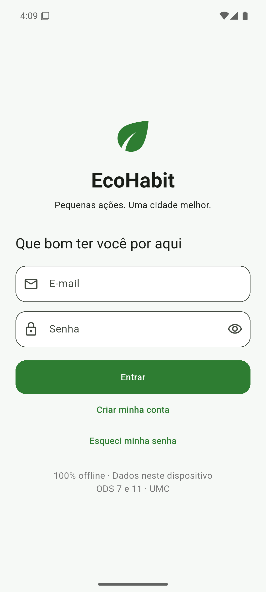
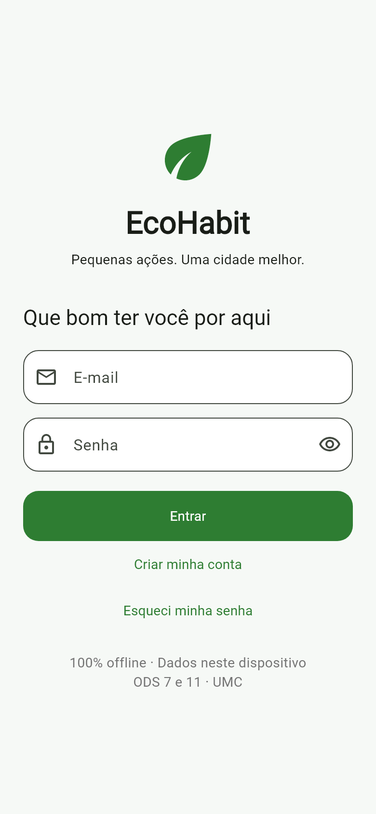
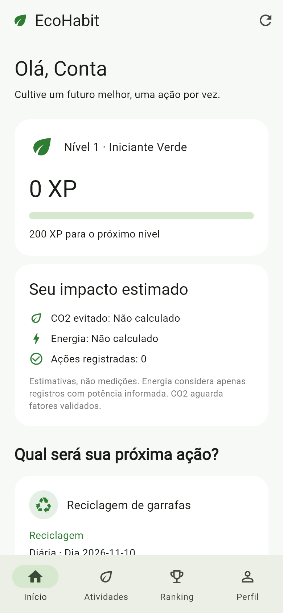
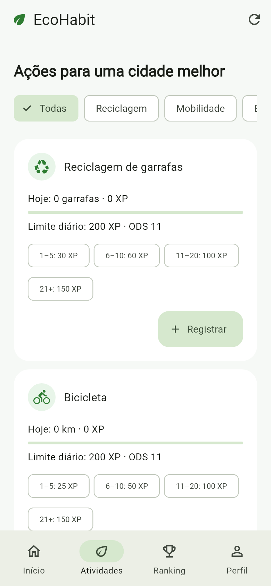
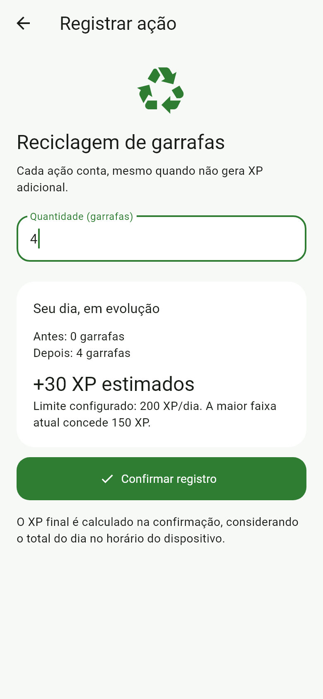
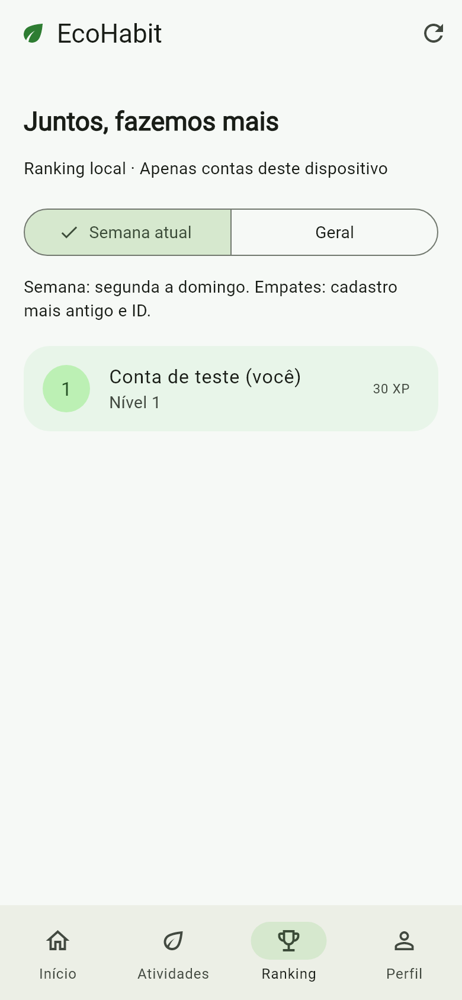
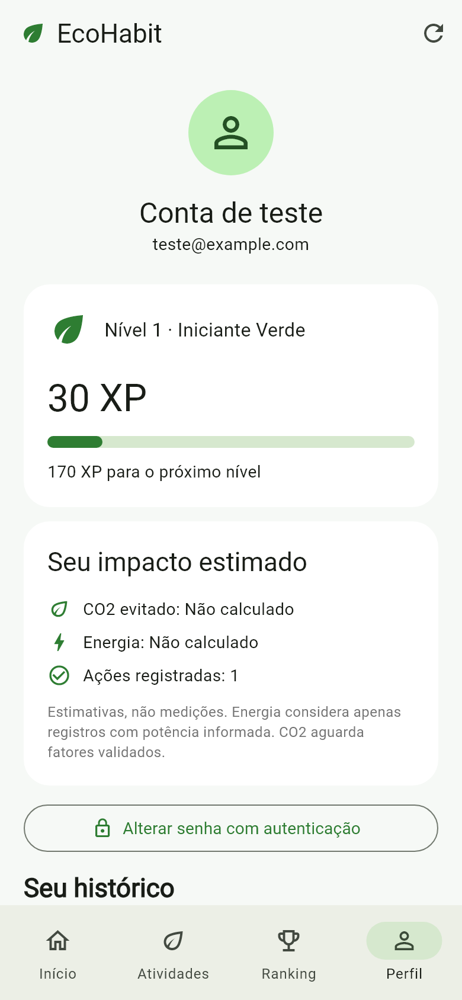

# EcoHabit V3 🌱

Plataforma gamificada de sustentabilidade urbana, desenvolvida em Flutter para Android como projeto acadêmico de Engenharia de Software da Universidade de Mogi das Cruzes (UMC), relacionada aos ODS 7 e 11.

O objetivo é incentivar hábitos sustentáveis por meio de **20 atividades em seis categorias**, com pontuação diária, mensal e conquistas únicas. O MVP funciona offline e guarda os dados em SQLite, sem serviços externos de armazenamento. Versão do aplicativo: **3.1.0+2**; versão do banco: **2**.

## Funcionalidades

- Cadastro e login locais, e-mail único, senha derivada com salt e sessão protegida.
- Recuperação offline autenticada por código secreto de uso único, com rotação; alteração de senha mediante senha atual; logout.
- Catálogo SQLite com 20 códigos estáveis, seis filtros de categoria, busca por nome/código e prévia de XP.
- XP acumulado por atividade/usuário/período: 15 atividades diárias, três mensais e duas conquistas únicas.
- Referência de trajeto/evento para impedir duplicidade entre atividades mutuamente exclusivas, além da idempotência por operação.
- Cards com quantidade e XP reais do período, limite, modalidade e status “Concluída” nas conquistas.
- Cinco níveis, progresso até o próximo nível e aviso de promoção.
- Início com resumo, perfil e histórico persistido, incluindo ações que concederam zero XP.
- Ranking geral e semanal entre contas reais do mesmo dispositivo.
- Estimativa de energia mediante potência informada; impactos sem fator validado apresentados como não calculados.
- Interface verde e branca, Material Design 3, navegação inferior e estados de erro/carregamento/vazio.

## Tecnologias e estrutura

Flutter estável 3.47.9, Dart 3.13.7, Provider, sqflite, cryptography, flutter_secure_storage, Material 3 e flutter_test. As versões efetivamente resolvidas estão em `pubspec.lock`, que deve ser versionado. Os testes de persistência usam `sqflite_common_ffi`.

```text
lib/
  main.dart
  app/                 Aplicativo, localização pt-BR e tema
  core/database/       Schema v1, migração atômica v1 → v2 e integridade
  core/constants/      Catálogo aprovado, categorias, ícones e cores
  models/              Entidades, níveis e datas locais
  repositories/        Autenticação e consultas/transações SQLite
  services/            Senhas e impacto ambiental
  providers/           Estado observável e coordenação
  screens/             Login/cadastro, navegação e registro
  widgets/             Cards e componentes compartilhados
test/                  Regras, persistência, widgets e fluxo integrado
android/               Projeto Android nativo gerado pelo Flutter
docs/                  Decisões técnicas e capturas
scripts/check.ps1      Verificação local no Windows
.github/workflows/     Verificações propostas para GitHub Actions
```

A arquitetura separa apresentação, domínio e persistência. Veja [decisões técnicas, segurança e fontes ambientais](docs/ARQUITETURA.md).

## Instalar e executar

Requisitos: Flutter estável compatível com o lockfile, Java 21, Android SDK com plataforma API 36, ferramentas de compilação e um dispositivo Android com depuração USB ou emulador. O projeto usa os valores de SDK/NDK recomendados pelo Flutter. A primeira preparação precisa de internet para baixar ferramentas e dependências; o aplicativo instalado funciona offline.

```sh
flutter pub get
flutter devices
flutter run -d <id-do-dispositivo-android>
```

Nesta máquina o SDK Flutter foi baixado para `.tools/flutter` e o Android SDK para `.tools/android-sdk`. Essas ferramentas locais não entram no Git. No PowerShell, é possível usar:

```powershell
$env:ANDROID_HOME = "$PWD\.tools\android-sdk"
$env:GRADLE_USER_HOME = "$PWD\.tools\gradle-cache"
# Configure JAVA_HOME para seu JDK 21, se ainda não estiver configurado.
.\.tools\flutter\bin\flutter.bat pub get
.\.tools\flutter\bin\flutter.bat run -d <id-do-dispositivo-android>
```

Não é um aplicativo web/Windows: o alvo do MVP é Android e a abertura de banco em produção usa o plugin sqflite Android. O FFI é usado apenas nos testes.

## Testar e gerar APK

```sh
flutter analyze
flutter test
flutter build apk --debug
```

Ou, no Windows: `powershell -File scripts/check.ps1 -BuildApk`. O script interrompe ao primeiro erro. O APK de depuração foi gerado em `build/app/outputs/flutter-apk/app-debug.apk` (165,3 MB; Android API 24+, ARM e x86_64). A assinatura foi verificada, e a inicialização foi confirmada no emulador Pixel 6 com Android 15 (API 35). A distribuição de produção requer assinatura própria; a configuração inicial de release ainda usa chave de depuração.

### VS Code e emulador

As extensões Flutter e Dart são recomendadas em `.vscode/extensions.json`. Abra `lib/main.dart`, selecione o dispositivo Android na barra de status e inicie a configuração **EcoHabit · Android** com F5. O caminho do SDK desta máquina fica em `.vscode/settings.json`, ignorado pelo Git; cada integrante deve configurar seu próprio SDK.

Na validação de 10/11/2026, `adb emu avd name` confirmou o AVD `Pixel_6`, e `flutter devices` identificou o dispositivo como `emulator-5554`. O aplicativo foi iniciado com:

```powershell
$env:ANDROID_HOME = "$PWD\.tools\android-sdk"
$env:GRADLE_USER_HOME = "$PWD\.tools\gradle-cache"
.\.tools\flutter\bin\flutter.bat run -d emulator-5554
```

O identificador pode mudar em outra execução: confira `flutter devices` antes de reutilizar o comando. Não é necessário instalar Visual Studio para desenvolver o alvo Android.

Para regenerar as capturas dos widgets reais, com conta exclusiva do teste e banco temporário:

```sh
flutter test test/app_flow_test.dart --dart-define=CAPTURE_SCREENSHOTS=true
```

Os testes cobrem autenticação e recuperação, as 66 faixas das 20 atividades, dias/meses/conquistas únicas, ações sem XP, viradas de dia/mês/ano, níveis, ranking, idempotência, referências duplicadas e concorrência. A migração é testada com banco v1 em arquivo, incluindo preservação de conta/sessão/XP e rollback completo em falha induzida. Os testes de interface verificam busca, categorias, registro mensal e bloqueio de conquista concluída, além do fluxo existente. O custo PBKDF2 é reduzido apenas no dublê de testes; não se trata de validação do Keystore em dispositivo Android.

Resultados efetivamente executados são registrados em [VALIDACAO.md](docs/VALIDACAO.md). A configuração de CI está preparada; não há execução remota de GitHub Actions alegada.

## Regras de pontuação

Todas as quantidades são **inteiros positivos** no MVP, inclusive km, horas, kg e kWh. Cada entrada aceita até 2.147.483.647 unidades. Valores fracionários, negativos, zero ou inválidos são rejeitados, sem conversão silenciosa.

| Categoria | Código estável / atividade | Unidade | Modalidade | Quantidade acumulada → XP | Limite XP |
| --- | --- | --- | --- | --- | --- |
| Mobilidade sustentável | `bicicleta` — Bicicleta | km | Diária | 1–5:25; 6–10:50; 11–20:100; 21+:150 | 150 |
| Mobilidade sustentável | `caminhada` — Caminhada | km | Diária | 1–2:20; 3–5:50; 6–10:90; 11+:130 | 130 |
| Mobilidade sustentável | `carro_eletrico` — Carro elétrico | km | Diária | 1–10:20; 11–30:40; 31+:60 | 60 |
| Mobilidade sustentável | `transporte_publico` — Transporte público | viagens | Diária | 1:15; 2:30; 3+:45 | 45 |
| Mobilidade sustentável | `carona` — Carona compartilhada | viagens | Diária | 1:15; 2:30; 3+:45 | 45 |
| Energia | `luzes_apagadas` — Economia de energia | minutos | Diária | 1–15:10; 16–30:25; 31–60:50; 61+:80 | 80 |
| Energia | `aparelhos_desligados` — Aparelhos desligados | horas | Diária | 1–2:15; 3–4:30; 5–8:60; 9+:90 | 90 |
| Energia | `energia_solar` — Energia solar gerada | kWh | Diária | 1–5:20; 6–15:45; 16+:70 | 70 |
| Energia | `instalar_solar` — Instalar energia solar | instalação | Única | 1:200 | 200 |
| Reciclagem | `garrafas_pet` — Reciclagem de garrafas | garrafas | Diária | 1–5:30; 6–10:60; 11–20:100; 21+:150 | 150 |
| Reciclagem | `latinhas` — Reciclagem de latinhas | unidades | Diária | 1–5:20; 6–15:50; 16–30:90; 31+:140 | 140 |
| Reciclagem | `papel_papelao` — Papel e papelão | kg | Diária | 1–2:20; 3–5:45; 6–10:80; 11+:120 | 120 |
| Reciclagem | `eletronicos` — Descarte de eletrônicos | itens | Mensal | 1:30; 2:55; 3+:80 | 80 |
| Água | `banho_reduzido` — Banho mais curto | minutos | Diária | 1–3:20; 4–6:40; 7–10:70; 11+:100 | 100 |
| Água | `agua_reutilizada` — Água reutilizada | litros | Diária | 1–5:20; 6–15:45; 16–30:80; 31+:120 | 120 |
| Água | `vazamento_corrigido` — Vazamento corrigido | reparos | Mensal | 1:60; 2+:100 | 100 |
| Consumo consciente | `copos_evitados` — Copos descartáveis evitados | unidades | Diária | 1–2:15; 3–5:35; 6–10:60; 11+:90 | 90 |
| Consumo consciente | `sacola_reutilizavel` — Sacola reutilizável | compras | Diária | 1:20; 2:35; 3–4:55; 5+:75 | 75 |
| Natureza | `arvores_plantadas` — Árvores plantadas | mudas | Mensal | 1:50; 2:90; 3+:120 | 120 |
| Natureza | `criar_composteira` — Criar uma composteira | instalação | Única | 1:150 | 150 |

`XP adicional = max(0, min(XP da nova faixa, limite) − XP já concedido no período)`.

Quatro registros de 4, 4, 4 e 2 garrafas concedem 30, 30, 40 e 0 XP. Todos ficam no histórico. Mensais somam entre diferentes dias do mesmo mês; por exemplo, eletrônicos de 1 + 1 + 1 + 1 itens concedem 30 + 25 + 25 + 0 XP. Conquistas únicas aceitam quantidade 1 e ficam bloqueadas após a primeira concessão, mesmo em outro mês/ano. Repetir uma operação idêntica retorna seu resultado original, sem criar outro registro.

As regras são lidas do SQLite e validadas: faixas contíguas, sem sobreposição/lacuna, XP não decrescente e modalidade/período compatíveis. A última faixa é aberta para diárias/mensais; conquistas têm apenas 1 unidade. Alterações futuras devem atualizar a versão da regra da atividade e a configuração correspondente em uma migração. O XP histórico nunca é recalculado ou editado manualmente.

### Períodos, datas e duplicidade

- Diárias: chave `YYYY-MM-DD`; mensais: `YYYY-MM`; únicas: chave `VIDA` por usuário/atividade.
- Só são aceitos registros do **momento atual**. Não há campo/API de data retroativa. Instante UTC, data local, período e versão são persistidos juntos, na transação, e não mudam ao alterar fuso depois.
- O dia/mês seguinte começa um novo agrupamento, sem apagar histórico nem XP total. O relógio do aparelho continua sendo uma limitação offline; alterar esse relógio não é uma forma confiável de validar ações reais.
- Mobilidade e atividades mensais exigem referência do trajeto/evento; nas demais ela é opcional. Use um código sem dados pessoais, como `trecho-2026-11-10-manha-1` ou `reparo-2026-11-10-1`.
- A mesma referência de mobilidade não pode ser usada em bicicleta, caminhada, carro elétrico, transporte público ou carona, nem repetida em outra data. Em viagens multimodais, identifique **trechos distintos reais** separadamente.
- Um reparo/descarte/plantio não pode ser reapresentado no mês seguinte com a mesma referência. Eventos novos precisam de referências novas. A comparação remove espaços extras e ignora maiúsculas/minúsculas.
- Há índice único de operação, índice único de ação por usuário/grupo/referência e índice único de conquista. A referência é autodeclarada: o MVP não reconhece o mesmo evento se alguém deliberadamente inventar outro código.

| Nível | Nome | XP total |
| --- | --- | --- |
| 1 | Iniciante Verde | 0–199 |
| 2 | Amigo da Natureza | 200–499 |
| 3 | Protetor Ambiental | 500–999 |
| 4 | Guardião Verde | 1.000–1.999 |
| 5 | Mestre Sustentável | 2.000+ (máximo) |

O ranking soma XP efetivamente concedido. A semana começa na segunda-feira e termina antes da segunda seguinte: o XP mensal entra na semana do registro que o concedeu, sem redistribuição retroativa. O desempate usa cadastro crescente e ID crescente. O nível é o nível total da conta, inclusive no ranking semanal. Contas sem atividade aparecem com zero XP; nenhum usuário fictício é inserido na instalação.

## SQLite

| Tabela | Conteúdo |
| --- | --- |
| `usuarios` | Identidade, e-mail único, hash/salt/custo da senha, bairro opcional e data de cadastro |
| `atividades` | Código estável único, nome, categoria, unidade, ODS, tipo/período, limite de XP, grupo de ação, versão e situação ativa |
| `faixas_pontuacao` | Atividade, mínimo, máximo opcional e XP |
| `registros` | Usuário, atividade, quantidade, XP concedido, estimativas, potência, data local/UTC, tipo/período/chave, versões, referência/grupo de ação e operação única |
| `configuracoes` | Parâmetros versionados, `versao_regra = xp-v2` |
| `recuperacao` | Hash, salt e custo do código secreto por usuário |

Chaves estrangeiras são habilitadas e verificadas. A migração transacional **v1 → v2** preserva usuários, hashes, recuperação, registros, XP, instantes e IDs legados: 1 → `garrafas_pet`, 2 → `bicicleta`, 3 → `luzes_apagadas`. Registros anteriores continuam `xp-v1`, com chave diária baseada na data local original. Os limites aprovados passam a 150/150/80 para essas atividades; os novos registros usam `xp-v2`.

O catálogo passa a 20 atividades ativas e 66 faixas. Não é reinserido ao reabrir o banco. Eventuais atividades locais extras são preservadas como legadas inativas, com seu histórico, em vez de apagadas. A coluna antiga `limite_xp_diario` fica por compatibilidade; v2 lê `limite_xp` por período. Há índices por usuário/dia, por usuário/atividade/período e restrições únicas para conquistas e ações. Um trigger valida a coerência da chave de período e quantidade de conquista. Falha de migração reverte inclusive o DDL e mantém a versão 1. XP total e nível continuam derivados.

## Impacto ambiental e limites do MVP

Energia: `kWh = potência_W × minutos / 60.000`, com potência fornecida pelo usuário a partir da etiqueta da lâmpada. Fonte dimensional: [EIA — Measuring electricity](https://www.eia.gov/energyexplained/electricity/measuring-electricity.php). O app não assume uma lâmpada padrão. A soma inclui apenas registros com potência conhecida.

CO₂ fica **não calculado** nesta versão: reciclagem precisa de material/massa e fator aplicável; mobilidade precisa de cenário substituído e fator validado; energia precisa de fator da rede. Nas novas atividades, são exibidas as quantidades diretas registradas, sem inventar conversões. kWh de energia solar são uma quantidade declarada de geração, não uma estimativa automática de energia evitada. Carros elétricos não emitem gases pelo escapamento, mas geração de energia e ciclo de vida também têm impactos. Os campos sem fator ficam `NULL`. Veja as hipóteses no documento de arquitetura.

As senhas usam PBKDF2-HMAC-SHA256 com 600.000 iterações, salt de 128 bits e hash de 256 bits. A sessão usa armazenamento protegido pelo sistema Android. O código de recuperação deve ser guardado pelo usuário fora do app; sem ele ou a senha não existe recuperação remota. Dados pessoais e ações ficam no SQLite privado, sem criptografia extra do arquivo. Root, alterações do banco/relógio e comprometimento do aparelho estão fora da proteção do MVP. Apagar os dados ou reinstalar pode perder o progresso. Não há sincronização nem ranking online.

## Capturas

Captura real da tela de login no emulador Pixel 6, Android 15, obtida por ADB após confirmar o processo do aplicativo em primeiro plano:



Capturas de widgets Flutter renderizados pelo teste integrado, com a conta explícita “Conta de teste”. Não representam execução em um aparelho ou emulador Android. Nenhuma conta de demonstração é criada na instalação normal.

| Login | Início | Atividades |
| --- | --- | --- |
|  |  |  |

| Registro | Ranking | Perfil |
| --- | --- | --- |
|  |  |  |

## Demonstração acadêmica

1. Instale e abra o app, crie uma conta e guarde o código de recuperação.
2. Registre 4, 4, 4 e 2 garrafas; confira incrementos de 30, 30, 40 e 0 XP.
3. Registre bicicleta ou energia; informe potência apenas se conhecida.
4. Veja os registros no perfil e o ranking local. Crie outra conta para comparar.
5. Feche e reabra o app para verificar sessão e progresso no aparelho.
6. Teste logout/login e, com o código guardado, recuperação offline.

## Equipe

- Breno Diniz Nascimento — Product Owner.
- Micael Nascimento de Sousa — Scrum Master.
- Samuel Dantas Lima da Silva — Analista de Sistemas (Dev).
- Victor Aparecido Sassati — Desenvolvedor.
